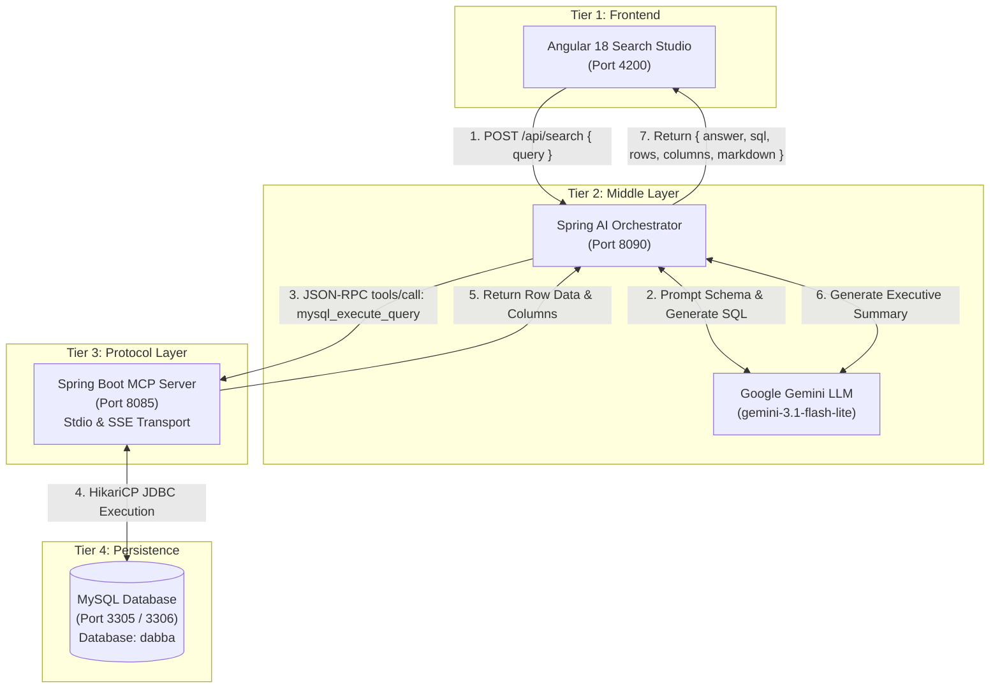

# Enterprise AI Database Search: Angular + Spring AI + Spring Boot MySQL MCP Server

[](https://spring.io/projects/spring-boot)
[](https://angular.dev/)
[](https://www.oracle.com/java/)
[](https://modelcontextprotocol.io/)
[](https://ai.google.dev/)
[](https://www.mysql.com/)
[](https://github.com/MAYANKPUROHIT93/enterprise-ai-database-search)

An enterprise-grade, four-tier **Natural Language Database Search Application**. Users can ask questions in plain English through an interactive **Angular 18** frontend. Queries are interpreted by a **Spring AI** middle layer powered by **Google Gemini**, routed through a dedicated **Spring Boot MySQL Model Context Protocol (MCP) Server**, executed against a **MySQL** database, and returned with structured Markdown insights and interactive data tables.

**GitHub Repository**: [https://github.com/MAYANKPUROHIT93/enterprise-ai-database-search](https://github.com/MAYANKPUROHIT93/enterprise-ai-database-search)

---

## 🏛️ System Architecture



---

## 📦 Project Structure

```
.
├── README.md                                  # Master System Documentation
├── employee_schema_and_data.sql               # Database DDL & Synthetic Data
├── angular-mcp-search-frontend/               # Tier 1: Angular 18 Frontend
│   ├── src/
│   │   ├── app/
│   │   │   ├── models/mcp.models.ts           # TypeScript Interfaces
│   │   │   ├── services/mcp-search.service.ts # HTTP API Client
│   │   │   ├── app.component.ts               # Core Search & Markdown Logic
│   │   │   ├── app.component.html             # Glassmorphic UI & Results Tabs
│   │   │   └── app.component.css              # Dark Design System
│   │   ├── index.html
│   │   ├── main.ts
│   │   └── styles.css
│   ├── angular.json
│   ├── package.json
│   └── tsconfig.json
│
├── spring-ai-mcp-orchestrator/                # Tier 2: Spring AI Middle-Layer
│   ├── pom.xml
│   └── src/main/
│       ├── java/com/example/orchestrator/
│       │   ├── SpringAiMcpOrchestratorApplication.java
│       │   ├── config/CorsConfig.java         # Cross-Origin Policies
│       │   ├── client/GeminiClientService.java# Google Gemini AI Integration
│       │   ├── client/McpClientService.java   # Spring Boot MCP Client
│       │   ├── controller/SearchController.java# REST Endpoints
│       │   └── dto/                           # Request / Response Models
│       └── resources/application.yml          # LLM & MCP Config
│
└── mysql-mcp-server-springboot/               # Tier 3: Spring Boot MCP Server
    ├── pom.xml
    └── src/main/
        ├── java/com/example/mysqlmcp/
        │   ├── MysqlMcpServerApplication.java
        │   ├── config/DataSourceConfig.java   # HikariCP Pool
        │   ├── service/SchemaService.java     # Database Introspection
        │   ├── service/QueryService.java      # Query Execution & DDL
        │   ├── service/AdminService.java      # Process List & Status
        │   ├── transport/StdioTransportRunner.java # Stdio Protocol
        │   ├── transport/SseMcpController.java# HTTP/SSE Protocol
        │   └── util/TableFormatter.java       # Markdown Table Generator
        └── resources/
            ├── application.yml
            └── logback-spring.xml              # Directs Logs to STDERR
```

---

## ⚙️ Configuration Guide: What Changes Users Must Make

To run this application in your own local or production environment, customize the configuration files as described below:

### 1. Spring Boot MCP Server (`mysql-mcp-server-springboot`)

File: `src/main/resources/application.yml` (or via Environment Variables):

| Property | Default Value | Description | What You Should Change |
|:---|:---|:---|:---|
| `mysql.host` | `127.0.0.1` | MySQL Host | Change to your MySQL IP or Docker host |
| `mysql.port` | `3305` | MySQL Port | Change to your MySQL port (e.g., `3306`) |
| `mysql.user` | `root` | MySQL User | Your MySQL username |
| `mysql.password` | `root` | MySQL Password | Your MySQL password |
| `mysql.database` | `dabba` | Database Name | Name of your target database schema |
| `mysql.pool-limit` | `10` | Max Pool Connections| Adjust based on server capacity |
| `mysql.read-only` | `false` | Mutation Guardrail | Set to `true` to block write queries |
| `server.port` | `8085` | HTTP/SSE Server Port | Change if port 8085 is in use |

---

### 2. Spring AI Orchestrator (`spring-ai-mcp-orchestrator`)

File: `src/main/resources/application.yml`:

| Property | Default Value | Description | What You Should Change |
|:---|:---|:---|:---|
| `server.port` | `8090` | API Port | Port on which the Spring AI backend runs |
| `gemini.api-key` | `YOUR_GEMINI_API_KEY` | Google Gemini API Key | **Provide your Google Gemini API Key** |
| `gemini.primary-model` | `gemini-3.1-flash-lite` | Primary LLM Model | `gemini-3.1-flash-lite`, `gemini-3.8-flash`, etc. |
| `mcp.server-url` | `http://127.0.0.1:8085/mcp/message` | MCP Server URL | Update if running on a remote server/port |
| `mcp.database` | `dabba` | Target Database | Target MySQL database name |
| `cors.allowed-origins` | `http://localhost:4200` | Allowed Origins | Add your production Angular domain |

---

### 3. Angular Frontend (`angular-mcp-search-frontend`)

File: `src/app/services/mcp-search.service.ts`:

```typescript
// If your Spring AI orchestrator runs on a different host or port, update this URL:
private readonly baseUrl = 'http://localhost:8090/api';
```

---

## 🚀 Step-by-Step Setup & Execution

### Step 1: Initialize Database & Seed Synthetic Data
Execute the provided SQL script against your MySQL server:
```bash
mysql -u root -p -h 127.0.0.1 -P 3306 < employee_schema_and_data.sql
```
This creates:
- Table **`department`** (`id`, `department_code`, `department_name`, `location`, `budget`, `created_at`)
- Table **`employee`** (`id`, `name`, `email`, `department`, `department_id`, `job_title`, `salary`, `hire_date`, `status`)
- Foreign key relationship: `employee.department_id -> department.id`
- 27 realistic employee records and 8 corporate departments.

---

### Step 2: Start the Spring Boot MySQL MCP Server
```bash
cd mysql-mcp-server-springboot
mvn clean package -DskipTests
java -jar target/mysql-mcp-server-springboot-1.0.0.jar
```
*The server will start listening on port `8085` (HTTP/SSE) and `System.in` (Stdio).*

---

### Step 3: Start the Spring AI Orchestrator
```bash
cd spring-ai-mcp-orchestrator
mvn clean package -DskipTests
java -jar target/spring-ai-mcp-orchestrator-1.0.0.jar
```
*The orchestrator starts on port `8090` and verifies connectivity with Gemini and the MCP server.*

---

### Step 4: Launch the Angular Frontend
```bash
cd angular-mcp-search-frontend
npm install
npm start
```
Open **`http://localhost:4200`** in your browser.

---

## 🌟 Key Features

1. **Intelligent Natural Language Search**:
   - Translate complex queries into optimized SQL:
     - *"Who are the top 5 highest paid employees with their department name?"*
     - *"What is the average salary and headcount per department?"*
     - *"Which department has the highest budget?"*
     - *"Show all employees on leave"*
2. **Interactive Data Table**:
   - Auto-generated responsive columns.
   - Formatted currency cells (`$185,000.00`).
   - Status badges (`ACTIVE`, `ON_LEAVE`, `TERMINATED`).
3. **Structured AI Insights**:
   - Gemini summaries formatted with bullet-point cards and bold metric callouts.
4. **Executed SQL Viewer**:
   - Inspect the generated SQL with syntax highlighting and one-click copy to clipboard.
5. **Data Exporting**:
   - Export query results instantly to **CSV** or **JSON**.
6. **Live Schema Explorer**:
   - Slide-out side drawer displaying database schemas, column data types, and primary/foreign keys.
7. **Direct SQL Mode**:
   - Toggle from natural language to execute raw MySQL DQL/DDL directly through the MCP pipeline.

---

## 🗄️ Custom Databases, Tables & Supported Operations

Users are **not limited to the sample employee/department tables**. You can plug in your own existing databases or create brand new databases, tables, and schemas dynamically.

### 1. How to Connect Your Own Database
You can point the system to any custom database in seconds:
1. In `mysql-mcp-server-springboot/src/main/resources/application.yml`:
   ```yaml
   mysql:
     database: my_custom_database   # <-- Set to your database name
   ```
2. In `spring-ai-mcp-orchestrator/src/main/resources/application.yml`:
   ```yaml
   mcp:
     database: my_custom_database
   ```
3. Update `SCHEMA_CONTEXT` in `GeminiClientService.java` with your custom tables and columns (or leverage dynamic MCP schema discovery via `mysql_describe_table` / `mysql_list_tables`).

---

### 2. Comprehensive Operations Users Can Perform

The system supports the full spectrum of database lifecycle operations across DDL, DML, DQL, Administration, and Profiling:

#### A. Database & Schema Management (DDL)
- **Create New Databases**:
  ```sql
  CREATE DATABASE ecommerce_db CHARACTER SET utf8mb4 COLLATE utf8mb4_unicode_ci;
  ```
- **Create Custom Tables**:
  ```sql
  CREATE TABLE customers (
      id BIGINT AUTO_INCREMENT PRIMARY KEY,
      full_name VARCHAR(150) NOT NULL,
      email VARCHAR(200) UNIQUE NOT NULL,
      membership_tier ENUM('STANDARD', 'GOLD', 'PLATINUM') DEFAULT 'STANDARD',
      total_spent DECIMAL(12,2) DEFAULT 0.00,
      created_at TIMESTAMP DEFAULT CURRENT_TIMESTAMP
  );
  ```
- **Alter & Migrate Tables**: Add/drop columns, change data types, and add constraints (`ALTER TABLE customers ADD COLUMN phone VARCHAR(20);`).
- **Create Foreign Keys & Relationships**: Link tables across 1-to-many or many-to-many relational schemas.
- **Index Management**: Create B-Tree or Fulltext indexes (`CREATE INDEX idx_email ON customers(email);`).

#### B. Data Manipulation & Operations (DML)
- **Insert Records**: Insert single or bulk records into any custom table.
- **Update Records**: Modify records with parametric or condition-based queries.
- **Delete Records**: Safe deletion with optional read-only mode protection (`mysql.read-only: true`).
- **Batch Script Migrations (`mysql_batch_execute`)**: Execute large `.sql` dump files containing multiple semicolon-separated statements in a single call.
- **ACID Transactions (`mysql_execute_transaction`)**: Execute multiple sequential statements atomically with automatic `COMMIT` or `ROLLBACK` on failure.

#### C. Intelligent Natural Language & Direct Querying (DQL)
- **Natural Language Aggregations**: Ask for sums, averages, counts, min/max, grouped by departments, dates, or custom fields.
- **Multi-Table Joins**: Automatic `INNER JOIN`, `LEFT JOIN`, and composite conditions generated by Gemini based on schema context.
- **Complex Filtering & Ordering**: Date range queries, pagination (`LIMIT`, `OFFSET`), pattern matching (`LIKE`, `REGEXP`), and ranking.
- **Direct SQL Execution Mode**: Switch toggle in the Angular UI or send direct raw queries to bypass the LLM.

#### D. Database Administration & Performance Monitoring
- **Schema Introspection**: List all tables, storage size, row counts, and column metadata (`mysql_list_tables`, `mysql_describe_table`).
- **Index & Constraint Auditing**: View cardinality, unique constraints, and foreign key definitions (`mysql_list_indexes`, `mysql_list_foreign_keys`).
- **Query Performance Profiling**: Profile slow queries using `EXPLAIN FORMAT=JSON` or `EXPLAIN ANALYZE` (`mysql_explain_query`).
- **Active Process Monitoring**: Inspect live connections and running threads (`mysql_process_list`).
- **Kill Stalled Queries**: Terminate runaway or hanging queries by connection ID (`mysql_kill_query`).
- **Server Health & Metrics**: Check database uptime, Queries Per Second (QPS), buffer pool usage, and slow query counts (`mysql_server_status`, `mysql_database_stats`).
- **External GUI Launch**: Export scripts and open queries directly in MySQL Workbench (`mysql_open_in_workbench`).

#### E. Data Exporting & Reporting
- **CSV Export**: Instant download of tabular query results for spreadsheet analysis.
- **JSON Export**: Clean structured export for API consumption or pipeline ingestion.
- **Executive Markdown Summaries**: AI-generated bullet points with bold highlights and key takeaway metrics.

---

## 🛠️ Supported MCP Tools

The Spring Boot MCP Server implements 16 native tools compliant with the **Model Context Protocol Specification (2024-11-05)**:

| Tool | Purpose |
|:---|:---|
| `mysql_ping` | Connection latency and health check |
| `mysql_list_databases` | Enumerate accessible schemas and character sets |
| `mysql_list_tables` | Table storage metrics and row counts |
| `mysql_describe_table` | Detailed column definitions and nullability |
| `mysql_show_create_table` | DDL extraction (`SHOW CREATE TABLE`) |
| `mysql_list_indexes` | Index types, uniqueness, and cardinality |
| `mysql_list_foreign_keys` | Foreign keys and referential constraints |
| `mysql_execute_query` | Parametric and arbitrary SQL execution |
| `mysql_explain_query` | `EXPLAIN FORMAT=JSON` / `EXPLAIN ANALYZE` profiling |
| `mysql_execute_transaction` | Atomic multi-statement ACID transaction |
| `mysql_batch_execute` | Semicolon-delimited script migration runner |
| `mysql_server_status` | Server uptime, threads, QPS, slow query counter |
| `mysql_database_stats` | Storage breakdown per database (Data/Index MB) |
| `mysql_process_list` | Active connections and currently running queries |
| `mysql_kill_query` | Terminate long-running or stalled queries |
| `mysql_open_in_workbench` | Save SQL script and launch MySQL Workbench GUI |

---

## 📄 License & Attribution

- **Developer**: **Mayank Sujat Purohit** ([@MAYANKPUROHIT93](https://github.com/MAYANKPUROHIT93))
- **License**: Released under the **MIT License**.
